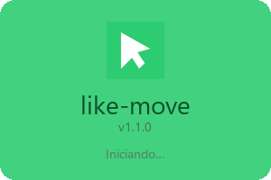
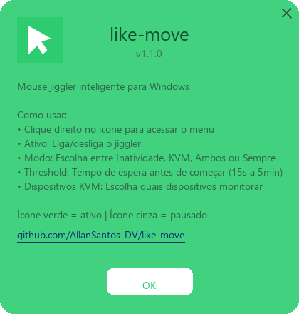

# like-move 🖱️

**Mantém o Windows sem bloquear, só quando você quer** — previne o bloqueio de tela por inatividade, com suporte especial a KVM switches e a redes Wi-Fi confiáveis. Não simula mouse nem teclado.

🌐 **Página do produto, com vídeo:** https://allansantos-dv.github.io/like-move/


---

## 📸 Telas

<p align="center">
  
  &nbsp;&nbsp;&nbsp;
  
</p>

<p align="center">
  
  &nbsp;&nbsp;
  
</p>

<p align="center"><sub>Ícone da bandeja (🟢 ativo / ⚫ pausado), splash e janela “Sobre” — telas geradas pelo próprio app (Pillow + Win32).</sub></p>

---

## ✨ Features

- **4 modos de trigger**: Inatividade, KVM (event-driven), Ambos ou Sempre
- **🔒 Redes Wi-Fi confiáveis** — mantém a tela acordada só em redes que você confia (casa/trabalho); em Wi-Fi público deixa bloquear. Casa por SSID **+ BSSID** (anti *evil-twin*)
- **⏱️ Prazo** — "Manter acordado por…" (30 min, 1 h, 2 h, 4 h ou até 12:00/18:00/22:00): 2 minutos antes do fim avisa, para você prorrogar, e no fim volta sozinho ao modo escolhido
- **🖥️ Programas vigiados** — mantém acordado enquanto um programa que você escolher estiver aberto (um render, um build, um download), sem lembrar de ligar o "Sempre"
- **📈 CPU ocupada** — mantém acordado enquanto o processador fica acima de 25%, 50% ou 75%, mesmo sem teclado nem mouse
- **Status ao vivo** — a primeira linha do menu diz por que o PC está (ou não) acordado, e avisos opcionais nas mudanças
- **🔋 Só na tomada**, **🪫 bateria mínima**, **🔐 bloquear a tela ao sair da rede confiável**, **🔒 bloquear a tela ao terminar** e **🌙 tela pode apagar** — opções que vêm desligadas
- **🩺 Diagnosticar bloqueio** — mostra o que bloqueia a tela no seu Windows e qual limite vence primeiro (somente leitura)
- **Sem simular entrada** — pede ao Windows "tela e sistema ligados" (`SetThreadExecutionState`); nada de mouse ou teclado falso
- **🔄 Auto-update** — verifica novas releases no GitHub e instala a nova versão ao lado da atual
- **Detecção de KVM via eventos do Windows** — usa `WM_DEVICECHANGE` (event-driven, sem polling)
- **Detecção de tela bloqueada** — libera o pedido quando a tela já está no Secure Desktop
- **System tray** — ícone colorido (🟢 ativo / ⚫ pausado) com menu completo
- **Iniciar com Windows** — opção sem admin (registro `HKCU`)
- **Configuração persistente** — preferências salvas em `%APPDATA%\like-move\config.json`
- **Standalone** — pasta pronta (`like-move.exe` + `_internal`), sem Python e sem instalar nada
- **Sem admin** — todas as APIs são user-space (Win32 via ctypes)

---

## 📥 Instalar

Com Node.js 20 ou mais novo, um comando no terminal (sem administrador):

```
npx like-move
```

Ele baixa `like-move-win64.zip` da release, confere o sha256 com o que vem dentro do [pacote npm](https://www.npmjs.com/package/like-move) (nada é instalado se não bater), extrai em `%LOCALAPPDATA%\Programs\like-move\like-move-<versão>` e abre o app. O ícone aparece na bandeja do sistema (system tray). Para o Home Awake: `npx like-move home-awake` (instala os scripts e roda o diagnóstico, somente leitura). Opções: `--dir <pasta>` instala em outra pasta, `--no-start` só instala.

Sem Node, baixe o zip na [página de releases](../../releases/latest):

> **[⬇ Baixar like-move-win64.zip](../../releases/latest/download/like-move-win64.zip)** — pasta pronta, não requer Python nem instalação.

Extraia o zip e abra `like-move\like-move.exe`.

---

## 🚀 Instalação

### Com npm (recomendado)

```
npx like-move
```

### Executável standalone (zip)

1. Baixe `like-move-win64.zip` na [página de releases](../../releases/latest)
2. Extraia numa pasta sua (ex.: `Documentos\like-move`) e abra `like-move.exe` — o ícone aparece na bandeja
3. Pronto! Não requer Python, admin ou instalação

### Desenvolvimento (Python)

```bash
# Clonar repositório
git clone https://github.com/AllanSantos-DV/like-move.git
cd like-move/like-move

# Instalar dependências
pip install -r requirements.txt

# Executar (sem janela de console)
pythonw main.pyw

# Ou com console (útil para debug/logs)
python main.pyw
```

**Requisitos**: Windows 10 ou 11 · Python 3.9+ (só para rodar do código; o `.exe` da release não precisa de Python)

---

## 🖥️ Uso

Ao executar, o like-move aparece como ícone na bandeja do sistema:

| Ícone | Estado |
|-------|--------|
| 🟢 Verde | Ativo — mantém o Windows acordado quando o modo pede |
| ⚫ Cinza | Pausado — o Windows bloqueia normalmente |

### Menu do tray

| Opção | Descrição |
|-------|-----------|
| *(primeira linha)* | Status ao vivo: "Acordado agora: KVM", "Aguardando: faltam 18s", "Parado: fora de rede confiável"… |
| **Ativo** | Liga/desliga o like-move (checkbox) |
| **Modo →** | Seleciona modo de trigger (Inatividade, KVM, Ambos, Sempre) |
| **Dispositivos KVM →** | Seleciona quais dispositivos monitorar (visível nos modos KVM/Ambos) |
| **Threshold →** | Tempo de inatividade antes de manter acordado (15s, 30s, 1min, 2min, 5min) |
| **Manter acordado por… →** | Mantém acordado por 30 min, 1 h, 2 h, 4 h ou até 12:00, 18:00 ou 22:00 e volta ao modo escolhido no fim; "Cancelar prazo" aparece enquanto há prazo |
| **Programas vigiados →** | Lista os programas vigiados (clique remove) e, em "Vigiar um programa", os que têm janela aberta agora; "Parar de vigiar todos" limpa. Enquanto algum vigiado roda, o PC fica acordado (status "Acordado agora: programa em execução") |
| **CPU ocupada →** | Desligado (padrão) ou acima de 25%, 50% ou 75% de uso do processador. Liga depois de cerca de 5 s seguidos acima do limite e só solta depois de cerca de 30 s abaixo, para um trabalho com pausas curtas não ligar e desligar o pedido (status "Acordado agora: CPU alta") |
| **Redes confiáveis →** | Marca/remove redes Wi-Fi confiáveis, liga "Só em redes confiáveis" e "Bloquear a tela ao sair da rede" |
| **Só na tomada** | Não mantém acordado enquanto o notebook está na bateria (desligado por padrão) |
| **Bateria mínima →** | Desligado (padrão) ou abaixo de 10%, 20% ou 30%: na bateria, solta o pedido quando a carga cai abaixo do mínimo (status "Parado: bateria baixa") e só o retoma 5 pontos acima dele ou na tomada, para a leitura oscilando não ligar e desligar o pedido. Na tomada nunca vale; carga desconhecida conta como não baixa |
| **Bloquear a tela ao terminar** | Quando um prazo, um programa vigiado ou a CPU ocupada que mantinha o PC acordado termina, bloqueia a tela (como Win+L) depois de cerca de 5 s seguidos já solto, para uma oscilação curta não bloquear. Não vale se você desligou o like-move ou mudou o modo, se o motivo era inatividade, KVM ou "Sempre", nem se a tela já estava bloqueada (desligado por padrão) |
| **Tela pode apagar** | O like-move só impede o PC de suspender (`ES_SYSTEM_REQUIRED`) e deixa a tela apagar pelo tempo do Windows; sem ele, a tela também fica ligada. Vale para todos os modos e gatilhos, e trocar a opção com o PC já acordado refaz o pedido na hora (desligado por padrão) |
| **Avisar nas mudanças** | Mostra um aviso quando o like-move passa a manter ou a soltar o PC (desligado por padrão) |
| **Diagnosticar bloqueio** | Lê (sem alterar nada) o que bloqueia a tela e abre o relatório `diagnostico.txt` de `%APPDATA%\like-move` |
| **Iniciar com Windows** | Inicia o like-move junto com o Windows (sem admin) |
| **Verificar atualizações** | Procura uma versão mais nova nas releases do GitHub |
| **Sobre** | Informações do app e link do repositório |
| **Sair** | Encerra o programa |

---

## 🎯 Modos de Trigger

| Modo | Comportamento |
|------|--------------|
| **Inatividade** | Mantém acordado quando o tempo sem input (mouse/teclado) ultrapassa o threshold. |
| **KVM** | Mantém acordado enquanto um dispositivo monitorado está desconectado (ex: KVM trocou para outro PC). Usa `WM_DEVICECHANGE` — event-driven, sem polling. |
| **Ambos** | Mantém acordado se **qualquer** condição for atendida (inatividade OU desconexão KVM). |
| **Sempre** | Mantém acordado enquanto o programa estiver ativo. Controle manual via toggle no tray. |

---

## 🔌 Dispositivos KVM

Nos modos **KVM** e **Ambos**, você pode selecionar quais dispositivos monitorar:

| Dispositivo | O que monitora | API |
|-------------|---------------|-----|
| **Monitor** | Contagem de monitores conectados | `GetSystemMetrics(SM_CMONITORS)` |
| **Mouse** | Dispositivos de mouse raw input | `GetRawInputDeviceList` (RIM_TYPEMOUSE) |
| **Teclado** | Dispositivos de teclado raw input | `GetRawInputDeviceList` (RIM_TYPEKEYBOARD) |

O like-move captura uma **baseline** na inicialização. Se a contagem de algum dispositivo monitorado cair abaixo da baseline, considera-se uma desconexão (= KVM trocou para outro PC) e o like-move mantém o Windows acordado.

---

## 🔒 Redes Wi-Fi confiáveis (segurança)

Deixar a tela bloquear é uma medida de segurança. Manter a máquina acordada em uma **rede pública** (café, aeroporto) pode expor a sessão a acesso não autorizado. Por isso o like-move pode agir só em **redes confiáveis**:

- Em **Redes confiáveis → Marcar rede atual como confiável**, o like-move lê a rede Wi-Fi conectada (SSID + BSSID) e a adiciona à lista.
- Ative **Só em redes confiáveis** para que o like-move só aja nessas redes. Em qualquer outra rede (ou Wi-Fi público), a tela bloqueia normalmente.
- O casamento usa **SSID + BSSID** (o MAC do ponto de acesso), resistindo a ataques *evil-twin* — uma rede falsa com o mesmo nome da sua não é aceita.
- Em conexão **cabeada** (sem Wi-Fi), o comportamento é configurável (`wired_is_trusted`, padrão: confiável).

| Opção do menu | Descrição |
|---------------|-----------|
| **Marcar rede atual como confiável** | Adiciona o Wi-Fi atual (SSID + BSSID) à lista |
| **Remover rede atual da lista** | Remove o Wi-Fi atual (visível se estiver na lista) |
| **Esquecer todas as redes** | Limpa a lista de confiáveis |
| **Só em redes confiáveis** | Liga o gate: age apenas em redes confiáveis |
| **Bloquear a tela ao sair da rede** | Desligado por padrão. Quando o PC deixa uma rede confiável (cinco leituras seguidas, para um soluço do Wi-Fi não bloquear), bloqueia a tela na hora, sem esperar o limite do Windows. Só age depois de ter estado numa rede confiável e com ao menos uma rede salva. Com "exigir o mesmo ponto de acesso" ligado, trocar de ponto de acesso na mesma rede também conta como sair |

Detecção via **WLAN API** (`wlanapi.dll`) por `ctypes` — sem `netsh` nem dependências extras.

---

## 🔄 Atualizações automáticas

O like-move verifica se há uma versão mais nova nas [releases do GitHub](../../releases/latest) e pode se atualizar sozinho:

- **Verificar ao iniciar** (padrão: ligado) — checa em segundo plano ao abrir e avisa se houver novidade.
- **Verificar atualizações** — checagem manual pelo menu.
- Quando há atualização, surge **Atualizar para vX.Y.Z**: o like-move baixa `like-move-win64.zip`, confere o sha256 com o `digest` que o GitHub publica para o asset (sem digest ou divergente, a atualização é recusada), extrai numa pasta ao lado (`like-move-X.Y.Z`) e abre a nova versão, que remove da pasta antiga só `like-move.exe` e `_internal` e reaponta "Iniciar com Windows". Nenhum script auxiliar troca arquivos em uso.
- Usa apenas a API pública de releases do GitHub e a stdlib (`urllib`) — sem servidores nem dependências extras.

---

## ⚙️ Configuração

Os valores padrão estão em `like_move/config.py`:

| Parâmetro | Padrão | Descrição |
|-----------|--------|-----------|
| `IDLE_THRESHOLD_SECONDS` | 30 | Segundos de inatividade antes de manter acordado |
| `CHECK_INTERVAL_SECONDS` | 1 | Intervalo de checagem do estado |

As preferências alteradas pelo menu (modo, threshold, dispositivos, redes confiáveis, prazo, tomada, avisos, auto-update) são **persistidas** em `%APPDATA%\like-move\config.json` e recarregadas na próxima execução. O `.exe` grava o registro de execução em `%APPDATA%\like-move\like-move.log` (até 1 MB, mais uma cópia anterior).

---

## 🔧 Como funciona

O like-move usa exclusivamente APIs Win32 via `ctypes` — sem `pywin32`, sem dependências nativas.

| Componente | API Win32 | Descrição |
|-----------|-----------|-----------|
| Detecção de idle | `GetLastInputInfo` + `GetTickCount64` | Calcula tempo desde último input real |
| Detecção de tela bloqueada | `OpenInputDesktop` | Retorna `NULL` quando a tela está no Secure Desktop |
| Manter acordado | `SetThreadExecutionState` | `ES_CONTINUOUS \| ES_SYSTEM_REQUIRED \| ES_DISPLAY_REQUIRED`; o Windows descarta o pedido quando o app fecha |
| Detecção de KVM | `WM_DEVICECHANGE` + hidden window | Event-driven: janela oculta recebe broadcasts de mudança de dispositivo |
| Contagem de dispositivos | `GetSystemMetrics`, `GetRawInputDeviceList` | Monitores, mouses e teclados conectados |
| Rede Wi-Fi atual | `WlanOpenHandle` / `WlanQueryInterface` | SSID + BSSID da rede conectada (gate de rede confiável) |
| Auto-update | GitHub Releases API + `urllib` + `zipfile` | Verifica, baixa e abre a nova versão numa pasta ao lado |

### Arquitetura

```
main.pyw                  → Entry point (sem console com pythonw)
like_move/
├── config.py             → Estado mutável persistido (TriggerMode, JigglerState)
├── settings.py           → Persistência JSON em %APPDATA%\like-move\config.json
├── detector.py           → Detecção de idle e tela bloqueada (ctypes)
├── device_monitor.py     → Monitor de dispositivos event-driven (WM_DEVICECHANGE)
├── wifi.py               → Rede Wi-Fi atual (SSID+BSSID) via WLAN API + gate de confiança
├── awake.py              → Decide quando manter acordado (SetThreadExecutionState) + thread de monitoramento, status, bloqueio ao sair da rede e vigia do pedido
├── triggers.py           → Gatilhos por programa em execução e por carga de CPU (lógica pura)
├── timer.py              → Prazo ("manter acordado por…"): fim e texto do tempo restante
├── diagnose.py           → Diagnóstico de bloqueio (lê as configurações pelo HomeAwake.psm1, somente leitura)
├── updater.py            → Auto-update via GitHub Releases (nova versão numa pasta ao lado)
├── tray.py               → System tray icon com pystray + menu configurável
├── splash.py             → Splash screen com fade (Win32 layered window)
├── about.py              → Janela "Sobre" (Win32 layered window)
└── startup.py            → Iniciar com Windows via registro HKCU (sem admin)
```

O monitor também confere, a cada ciclo em que mantém o pedido, se o sistema ainda mostra os bits de tela e sistema ligados (`CallNtPowerInformation`, estado de execução do sistema): se o pedido sumiu (por exemplo, no Modern Standby com bateria), registra um aviso no log e o reafirma uma vez. Os gatilhos de programa e de CPU valem em qualquer modo e passam pelas mesmas travas: tela bloqueada, rede não confiável e bateria (com "Só na tomada") ainda soltam o pedido. A lista de programas vem do Windows (Toolhelp) e a carga de CPU de `GetSystemTimes`; nada disso sai do PC. A CPU é a do sistema todo, então um PC já carregado por outros programas fica acordado enquanto estiver acima do limite.

Como o estado soma os pedidos de todos os programas, ele só acusa perda quando nenhum programa mantém a tela; se outro programa a mantém, a perda do nosso pedido não aparece.

**Threads:**
- **Principal** — event loop do pystray (system tray)
- **Monitor** — thread daemon que checa idle/KVM e liga/libera o pedido ao Windows
- **DeviceMonitor** — thread daemon com message pump Win32 para `WM_DEVICECHANGE`

---

## 🏗️ Build

### Build local

```powershell
# Instalar dependências
pip install -r requirements.txt pyinstaller

# Build via script (gera dist\like-move\ e dist\like-move-win64.zip)
.\build.ps1

# Com o bootloader do PyInstaller compilado localmente (exige Visual Studio Build Tools)
.\build.ps1 -CompileBootloader
```

O build também gera `dist\home-awake.zip` (só os scripts e o LEIA-ME), pelo mesmo `package-home-awake.ps1` que a CI usa.

O build sai em pasta (`onedir`), sem UPX e com metadados de versão no `.exe`: o modo arquivo único extrai tudo para `%TEMP%` e o UPX comprime os binários, duas heurísticas clássicas de antivírus.

### Testes

```bash
python -m unittest discover -s tests -v
```

Home Awake (Pester 3.4, que vem com o Windows):

```powershell
powershell -NoProfile -ExecutionPolicy Bypass -Command "Import-Module Pester -RequiredVersion 3.4.0; Invoke-Pester .\home-awake\tests\HomeAwake.Tests.ps1"
```

### CI/CD

O GitHub Actions não roda suíte de teste nem runner Windows/macOS: os testes e a verificação rodam localmente antes de cada publicação (`python -m unittest discover -s tests -v` em `like-move/`, Pester do Home Awake e `cd npm && npm test`). Só ficam dois workflows leves, em `ubuntu-latest`: `Deploy Pages` e `Publish npm`. `tests/test_workflows_guard.py` falha se um workflow usar `windows-*`/`macos-*` em `runs-on` ou tiver passo de teste.

A release é construída localmente, porque o `.exe` do PyInstaller só se gera no Windows: na `main`, com o commit já fast-forwarded e a suíte verde, rode `.\build.ps1 -CompileBootloader` (gera `like-move-win64.zip` e `home-awake.zip`), crie a tag `v<VERSION>` e a release como **rascunho** com os dois zips (`gh release create v<VERSION> --draft ...`). Ela só é publicada depois de baixada e verificada pelo antivírus.

Publicar a release dispara o workflow `Publish npm` (e, se o GitHub deixar de iniciá-lo, uma rodada agendada a cada 6 h publica a última release que o npm ainda não tem): confere que a tag bate com o `VERSION` e com o `npm/package.json` e que o commit está na `main`, baixa os dois zips e grava o sha256 deles em `npm/release.json` (cada hash tem de bater com o digest que o GitHub publica) e publica `like-move` no npm por publicação confiável (OIDC), com proveniência. Ao subir o `VERSION`, suba junto a `version` de `npm/package.json`.

O site (`site/`) sai pela branch `gh-pages`, sem artefato do Actions: a cada mudança dele na `main`, o `Deploy Pages` roda `pages.py publish`, que monta um commit órfão só com os arquivos versionados de `site/` (mais `.nojekyll`), carimba o `index.html` com `<meta name="like-move-version" content="<VERSION> <commit>">` e faz push forçado na `gh-pages` com a chave de deploy do segredo `PAGES_DEPLOY_KEY`; em seguida `pages.py verify` lê a página pública até ela ser a publicada, ou falha. O Pages está em "Deploy from a branch", `gh-pages`, `/`. Para reverter: `gh api -X PUT repos/<owner>/<repo>/pages -f build_type=workflow` e `git revert` do commit da migração.

### Regenerar ícone

```bash
python assets/generate_ico.py
```

### Regenerar as telas de preview

```bash
python assets/generate_previews.py
# → gera site/assets/*.png a partir das telas reais do app (sem abrir janelas)
```

Há também uma página de vitrine estática em [`site/index.html`](site/index.html) (pronta para GitHub Pages).

---

## 🤝 Contribuição

1. Fork o repositório
2. Crie uma branch para sua feature (`git checkout -b feature/minha-feature`)
3. Commit suas mudanças (`git commit -m 'feat: minha feature'`)
4. Push para a branch (`git push origin feature/minha-feature`)
5. Abra um Pull Request

---

## 📄 Licença

[MIT](../LICENSE) © Allan Santos

---

## 🏠 Home Awake (`home-awake/`)

Tela sem bloquear **só no Wi-Fi de casa cadastrado**, sem simular entrada, sem executável e sem alterar configurações: PowerShell legível + `SetThreadExecutionState`.
Para instalar: `npx like-move home-awake` (ou baixe `home-awake.zip` na [página de releases](../../releases/latest)). Veja `home-awake/LEIA-ME.txt`: passo a passo, o que cada resultado da autoverificação significa e os limites.
