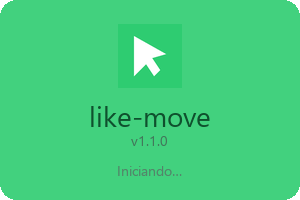
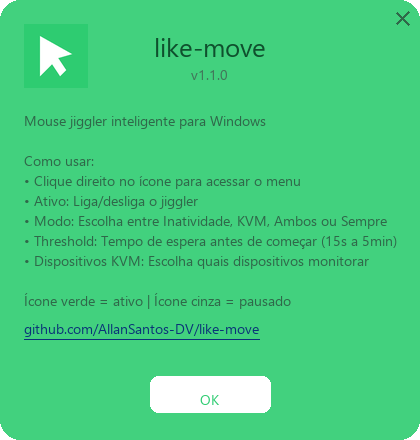

# like-move 🖱️

**Mantém o Windows sem bloquear, só quando você quer** — previne o bloqueio de tela por inatividade, com suporte especial a KVM switches e a redes Wi-Fi confiáveis. Não simula mouse nem teclado.

🌐 **Página do produto, com vídeo:** https://allansantos-dv.github.io/like-move/


---

## 📸 Telas

<p align="center">
  
  &nbsp;&nbsp;&nbsp;
  
</p>

<p align="center">
  
  &nbsp;&nbsp;
  
</p>

<p align="center"><sub>Ícone da bandeja (🟢 ativo / ⚫ pausado), splash e janela “Sobre” — telas geradas pelo próprio app (Pillow + Win32).</sub></p>

---

## ✨ Features

- **4 modos de trigger**: Inatividade, KVM (event-driven), Ambos ou Sempre
- **🔒 Redes Wi-Fi confiáveis** — mantém a tela acordada só em redes que você confia (casa/trabalho); em Wi-Fi público deixa bloquear. Casa por SSID **+ BSSID** (anti *evil-twin*)
- **Sem simular entrada** — pede ao Windows "tela e sistema ligados" (`SetThreadExecutionState`); nada de mouse ou teclado falso
- **🔄 Auto-update** — verifica novas releases no GitHub e instala a nova versão ao lado da atual
- **Detecção de KVM via eventos do Windows** — usa `WM_DEVICECHANGE` (event-driven, sem polling)
- **Detecção de tela bloqueada** — libera o pedido quando a tela já está no Secure Desktop
- **System tray** — ícone colorido (🟢 ativo / ⚫ pausado) com menu completo
- **Iniciar com Windows** — opção sem admin (registro `HKCU`)
- **Configuração persistente** — preferências salvas em `%APPDATA%\like-move\config.json`
- **Standalone** — pasta pronta (`like-move.exe` + `_internal`), sem Python e sem instalar nada
- **Sem admin** — todas as APIs são user-space (Win32 via ctypes)

---

## 📥 Download

Baixe a versão mais recente na [página de releases](../../releases/latest):

> **[⬇ Baixar like-move-win64.zip](../../releases/latest/download/like-move-win64.zip)** — pasta pronta, não requer Python nem instalação.

Extraia o zip e abra `like-move\like-move.exe`. O ícone aparece na bandeja do sistema (system tray).

---

## 🚀 Instalação

### Executável standalone (recomendado)

1. Baixe `like-move-win64.zip` na [página de releases](../../releases/latest)
2. Extraia numa pasta sua (ex.: `Documentos\like-move`) e abra `like-move.exe` — o ícone aparece na bandeja
3. Pronto! Não requer Python, admin ou instalação

### Desenvolvimento (Python)

```bash
# Clonar repositório
git clone https://github.com/AllanSantos-DV/like-move.git
cd like-move/like-move

# Instalar dependências
pip install -r requirements.txt

# Executar (sem janela de console)
pythonw main.pyw

# Ou com console (útil para debug/logs)
python main.pyw
```

**Requisitos**: Windows 7/8/10/11 · Python 3.8+

---

## 🖥️ Uso

Ao executar, o like-move aparece como ícone na bandeja do sistema:

| Ícone | Estado |
|-------|--------|
| 🟢 Verde | Ativo — mantém o Windows acordado quando o modo pede |
| ⚫ Cinza | Pausado — o Windows bloqueia normalmente |

### Menu do tray

| Opção | Descrição |
|-------|-----------|
| **Ativo** | Liga/desliga o like-move (checkbox) |
| **Modo →** | Seleciona modo de trigger (Inatividade, KVM, Ambos, Sempre) |
| **Dispositivos KVM →** | Seleciona quais dispositivos monitorar (visível nos modos KVM/Ambos) |
| **Threshold →** | Tempo de inatividade antes de manter acordado (15s, 30s, 1min, 2min, 5min) |
| **Redes confiáveis →** | Marca/remove redes Wi-Fi confiáveis e liga "Só em redes confiáveis" |
| **Iniciar com Windows** | Inicia o like-move junto com o Windows (sem admin) |
| **Verificar atualizações** | Procura uma versão mais nova nas releases do GitHub |
| **Sobre** | Informações do app e link do repositório |
| **Sair** | Encerra o programa |

---

## 🎯 Modos de Trigger

| Modo | Comportamento |
|------|--------------|
| **Inatividade** | Mantém acordado quando o tempo sem input (mouse/teclado) ultrapassa o threshold. |
| **KVM** | Mantém acordado enquanto um dispositivo monitorado está desconectado (ex: KVM trocou para outro PC). Usa `WM_DEVICECHANGE` — event-driven, sem polling. |
| **Ambos** | Mantém acordado se **qualquer** condição for atendida (inatividade OU desconexão KVM). |
| **Sempre** | Mantém acordado enquanto o programa estiver ativo. Controle manual via toggle no tray. |

---

## 🔌 Dispositivos KVM

Nos modos **KVM** e **Ambos**, você pode selecionar quais dispositivos monitorar:

| Dispositivo | O que monitora | API |
|-------------|---------------|-----|
| **Monitor** | Contagem de monitores conectados | `GetSystemMetrics(SM_CMONITORS)` |
| **Mouse** | Dispositivos de mouse raw input | `GetRawInputDeviceList` (RIM_TYPEMOUSE) |
| **Teclado** | Dispositivos de teclado raw input | `GetRawInputDeviceList` (RIM_TYPEKEYBOARD) |

O like-move captura uma **baseline** na inicialização. Se a contagem de algum dispositivo monitorado cair abaixo da baseline, considera-se uma desconexão (= KVM trocou para outro PC) e o like-move mantém o Windows acordado.

---

## 🔒 Redes Wi-Fi confiáveis (segurança)

Deixar a tela bloquear é uma medida de segurança. Manter a máquina acordada em uma **rede pública** (café, aeroporto) pode expor a sessão a acesso não autorizado. Por isso o like-move pode agir só em **redes confiáveis**:

- Em **Redes confiáveis → Marcar rede atual como confiável**, o like-move lê a rede Wi-Fi conectada (SSID + BSSID) e a adiciona à lista.
- Ative **Só em redes confiáveis** para que o like-move só aja nessas redes. Em qualquer outra rede (ou Wi-Fi público), a tela bloqueia normalmente.
- O casamento usa **SSID + BSSID** (o MAC do ponto de acesso), resistindo a ataques *evil-twin* — uma rede falsa com o mesmo nome da sua não é aceita.
- Em conexão **cabeada** (sem Wi-Fi), o comportamento é configurável (`wired_is_trusted`, padrão: confiável).

| Opção do menu | Descrição |
|---------------|-----------|
| **Marcar rede atual como confiável** | Adiciona o Wi-Fi atual (SSID + BSSID) à lista |
| **Remover rede atual da lista** | Remove o Wi-Fi atual (visível se estiver na lista) |
| **Esquecer todas as redes** | Limpa a lista de confiáveis |
| **Só em redes confiáveis** | Liga o gate: age apenas em redes confiáveis |

Detecção via **WLAN API** (`wlanapi.dll`) por `ctypes` — sem `netsh` nem dependências extras.

---

## 🔄 Atualizações automáticas

O like-move verifica se há uma versão mais nova nas [releases do GitHub](../../releases/latest) e pode se atualizar sozinho:

- **Verificar ao iniciar** (padrão: ligado) — checa em segundo plano ao abrir e avisa se houver novidade.
- **Verificar atualizações** — checagem manual pelo menu.
- Quando há atualização, surge **Atualizar para vX.Y.Z**: o like-move baixa `like-move-win64.zip`, extrai numa pasta ao lado (`like-move-X.Y.Z`) e abre a nova versão, que remove da pasta antiga só `like-move.exe` e `_internal` e reaponta "Iniciar com Windows". Nenhum script auxiliar troca arquivos em uso.
- Usa apenas a API pública de releases do GitHub e a stdlib (`urllib`) — sem servidores nem dependências extras.

---

## ⚙️ Configuração

Os valores padrão estão em `like_move/config.py`:

| Parâmetro | Padrão | Descrição |
|-----------|--------|-----------|
| `IDLE_THRESHOLD_SECONDS` | 30 | Segundos de inatividade antes de manter acordado |
| `CHECK_INTERVAL_SECONDS` | 1 | Intervalo de checagem do estado |

As preferências alteradas pelo menu (modo, threshold, dispositivos, redes confiáveis, auto-update) são **persistidas** em `%APPDATA%\like-move\config.json` e recarregadas na próxima execução.

---

## 🔧 Como funciona

O like-move usa exclusivamente APIs Win32 via `ctypes` — sem `pywin32`, sem dependências nativas.

| Componente | API Win32 | Descrição |
|-----------|-----------|-----------|
| Detecção de idle | `GetLastInputInfo` + `GetTickCount64` | Calcula tempo desde último input real |
| Detecção de tela bloqueada | `OpenInputDesktop` | Retorna `NULL` quando a tela está no Secure Desktop |
| Manter acordado | `SetThreadExecutionState` | `ES_CONTINUOUS \| ES_SYSTEM_REQUIRED \| ES_DISPLAY_REQUIRED`; o Windows descarta o pedido quando o app fecha |
| Detecção de KVM | `WM_DEVICECHANGE` + hidden window | Event-driven: janela oculta recebe broadcasts de mudança de dispositivo |
| Contagem de dispositivos | `GetSystemMetrics`, `GetRawInputDeviceList` | Monitores, mouses e teclados conectados |
| Rede Wi-Fi atual | `WlanOpenHandle` / `WlanQueryInterface` | SSID + BSSID da rede conectada (gate de rede confiável) |
| Auto-update | GitHub Releases API + `urllib` + `zipfile` | Verifica, baixa e abre a nova versão numa pasta ao lado |

### Arquitetura

```
main.pyw                  → Entry point (sem console com pythonw)
like_move/
├── config.py             → Estado mutável persistido (TriggerMode, JigglerState)
├── settings.py           → Persistência JSON em %APPDATA%\like-move\config.json
├── detector.py           → Detecção de idle e tela bloqueada (ctypes)
├── device_monitor.py     → Monitor de dispositivos event-driven (WM_DEVICECHANGE)
├── wifi.py               → Rede Wi-Fi atual (SSID+BSSID) via WLAN API + gate de confiança
├── awake.py              → Decide quando manter acordado (SetThreadExecutionState) + thread de monitoramento
├── updater.py            → Auto-update via GitHub Releases (nova versão numa pasta ao lado)
├── tray.py               → System tray icon com pystray + menu configurável
├── splash.py             → Splash screen com fade (Win32 layered window)
├── about.py              → Janela "Sobre" (Win32 layered window)
└── startup.py            → Iniciar com Windows via registro HKCU (sem admin)
```

**Threads:**
- **Principal** — event loop do pystray (system tray)
- **Monitor** — thread daemon que checa idle/KVM e liga/libera o pedido ao Windows
- **DeviceMonitor** — thread daemon com message pump Win32 para `WM_DEVICECHANGE`

---

## 🏗️ Build

### Build local

```powershell
# Instalar dependências
pip install -r requirements.txt pyinstaller

# Build via script (gera dist\like-move\ e dist\like-move-win64.zip)
.\build.ps1

# Com o bootloader do PyInstaller compilado localmente (exige Visual Studio Build Tools)
.\build.ps1 -CompileBootloader
```

O build sai em pasta (`onedir`), sem UPX e com metadados de versão no `.exe`: o modo arquivo único extrai tudo para `%TEMP%` e o UPX comprime os binários, duas heurísticas clássicas de antivírus.

### Testes

```bash
python -m unittest discover -s tests -v
```

Home Awake (Pester 3.4, que vem com o Windows):

```powershell
powershell -NoProfile -Command "Invoke-Pester .\home-awake\tests\HomeAwake.Tests.ps1"
```

### CI/CD

O workflow de release roda ao criar uma tag `v*` na `master`: compila o bootloader do PyInstaller no runner, roda os testes do Python e do Home Awake, gera `like-move-win64.zip` e `home-awake.zip` e cria a release como **rascunho**. Ela só é publicada depois de baixada e verificada pelo antivírus.

### Regenerar ícone

```bash
python assets/generate_ico.py
```

### Regenerar as telas de preview

```bash
python assets/generate_previews.py
# → gera site/assets/*.png a partir das telas reais do app (sem abrir janelas)
```

Há também uma página de vitrine estática em [`site/index.html`](site/index.html) (pronta para GitHub Pages).

---

## 🤝 Contribuição

1. Fork o repositório
2. Crie uma branch para sua feature (`git checkout -b feature/minha-feature`)
3. Commit suas mudanças (`git commit -m 'feat: minha feature'`)
4. Push para a branch (`git push origin feature/minha-feature`)
5. Abra um Pull Request

---

## 📄 Licença

[MIT](../LICENSE) © Allan Santos

---

## 🏠 Home Awake (`home-awake/`)

Tela sem bloquear **só no Wi-Fi de casa cadastrado**, sem simular entrada, sem executável e sem alterar configurações: PowerShell legível + `SetThreadExecutionState`.
Veja `home-awake/LEIA-ME.txt`: passo a passo, o que cada resultado da autoverificação significa e os limites.
